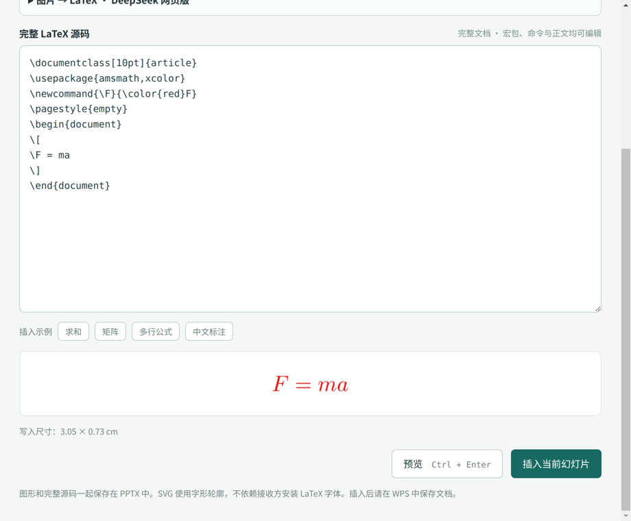
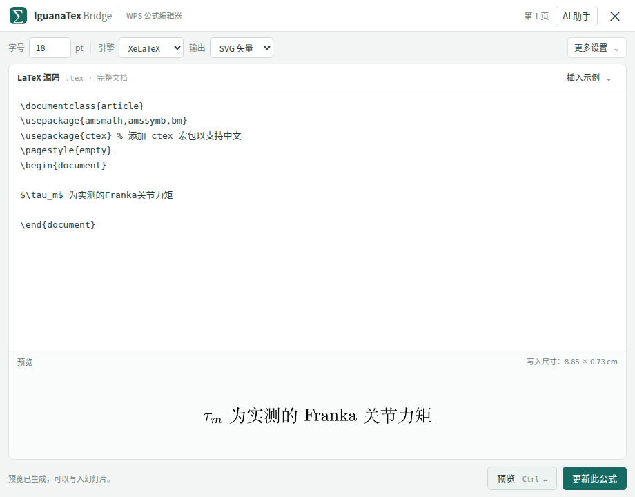
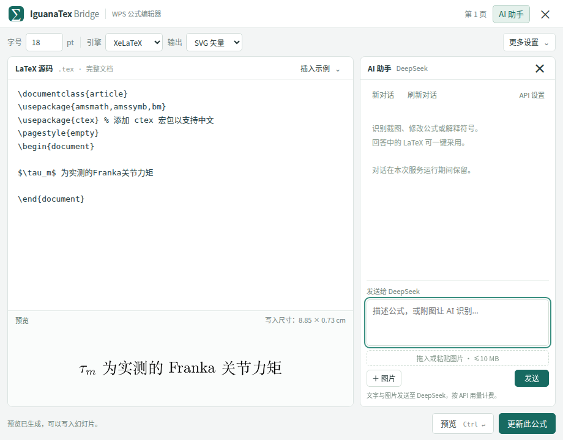

# IguanaTex Bridge 0.6.1 · 桌面公式编辑器与 PowerPoint / WPS 加载项

WPS 工具栏可直接打开完整 LaTeX 编辑器。内置 [OpenAI API 对话](docs/API_CHAT.md)：输入文字、附加截图、连续追问，完整回答保留在面板中，点击“采用 LaTeX”后再预览写入。首次展开“API 设置”保存 OpenAI API Key。另有 [独立桌面 GUI](docs/DESKTOP.md) 与 [macOS / Windows PowerPoint 安装](docs/INSTALL_OFFICE.md)。

在 Ubuntu 的 **WPS 演示顶部 IguanaTex 功能区**中直接新建和编辑 LaTeX 公式。完整源码随 PPTX 保存，使用 IguanaTex 的原生标签格式，供 Windows / macOS 的 PowerPoint + IguanaTex 继续编辑。

**原有功能已在 Ubuntu + WPS 12.8.2.21176 实测；0.4.0 已在 Mac PowerPoint 16.113.3 实测自己的 Office 加载项和桌面识别流程。Windows 与新增 Ubuntu GUI / OCR 仍待实机验证。**

## 此前 Ubuntu 电脑的安装状态

本项目所在目录已注册到 WPS，并配置当前用户的后台服务。WPS 顶部已有 **IguanaTex** 标签。日常无需手动打开终端或导入、导出文稿。

此目录是当前安装位置，请保留。移动目录后，应在新位置重新运行安装脚本。安装包不携带 Python、TeX Live 或上游 IguanaTex。

## 完整 LaTeX 文档编辑

新建公式时，编辑区直接提供完整文档，包括 `\documentclass`、`\usepackage`、`\begin{document}` 和 `\end{document}`。可以在导言区添加宏包、定义命令，再修改正文公式；字号仍通过顶部控件调整。

编辑区显示的代码就是实际编译并保存到公式中的源码，与 IguanaTex 的完整文档编辑方式一致。已有完整源码原样保留，包括自定义宏包、命令和注释。若粘贴公式片段，点击预览时会先把完整文档显示出来，再进行编译；编译失败时也可直接查看和修改全部代码。

默认模板如下（新建时正文为 `E = mc^{2}`）：

```latex
\documentclass[10pt]{article}
\usepackage{amsmath,amssymb,bm}
\usepackage{iftex}
\ifPDFTeX
  \usepackage[T1]{fontenc}
\else
  \usepackage[fontset=fandol]{ctex}
\fi
\pagestyle{empty}
\begin{document}
\[
E = mc^{2}
\]
\end{document}
```

中文选择 XeLaTeX 或 LuaLaTeX；pdfLaTeX 分支不加载中文宏包。默认文档按 10 pt 编译，再由字号控件按 IguanaTex 规则缩放。自行改动 `documentclass` 的基准字号时，请同时留意这个缩放关系。

截图识别返回公式片段时，只替换现有文档的正文，保留导言区；返回完整文档时采用该完整文档。已有源码结构不完整或等待期间又修改了源码时，会保留识别结果供手动核对，不覆盖原文。桌面端“复制 TeX”和“保存 TeX”也输出完整文档。

新建 / 编辑时点击右上角“AI 助手”打开对话侧栏；PowerPoint 的“截图识别”入口直接打开。旧版独立 Qt 桌面端仍使用自己的截图识别区。



## 日常使用

1. 在 WPS 演示中打开或新建文稿，选中目标幻灯片。
2. 点击 **IguanaTex → 新建公式**，编辑包含导言区和正文的完整 LaTeX 文档。
3. 点击 **预览**（快捷键 Ctrl+Enter，Mac 为 Command+Enter），再点击 **插入当前幻灯片**。
4. 以后选中公式图片、SVG 或 IguanaTex Shape 组合，点击 **编辑选中公式**，修改后点击 **更新此公式**。
5. 插入或更新成功后编辑器自动关闭；预览、编译失败或写入失败时保持打开。在 WPS 中正常保存为 `.pptx`。图片为嵌入对象，换电脑不依赖临时图片路径。

0.6.0 使用紧凑工作台：顶部仅保留字号、引擎和输出；源码独立滚动，预览和操作按钮固定在下方。“更多设置”提供更新尺寸规则和兼容性说明，源码右上角“插入示例”提供常用公式。AI 助手按需在侧边打开，回答独立滚动；小窗口使用抽屉，收起后回到源码与预览。按 Esc 可收起菜单或 AI。





功能区还提供：

- **API 设置**：直接填写 OpenAI API Key 和模型；本机手动密钥优先于环境变量，图片转换与 AI 助手共同使用。留空保存会保留已有密钥。
- **检查与同步源码**：扫描当前演示文稿，以 IguanaTex 原生标签为准更新替代文字备份；标签丢失时尝试恢复。完成后请保存文稿。
- **环境与帮助**：检查 XeLaTeX / pdfLaTeX / LuaLaTeX 是否可用，查看操作说明。

**IguanaTex Shape / 矢量组合可以直接编辑，无需 Convert to Picture。** 插件读取原生源码，更新为 SVG 矢量图形；字体转换为轮廓，放大清晰，接收方无需安装相同字体。也可手动选择透明 PNG。点击 Shape 组合中的单个字符时，会定位到整条公式。

更新 PNG、SVG 和 Shape 默认**按字号重设尺寸**，按照当前字号和完整公式内容重新计算宽高，保持自然比例；也可在“更多设置 → 更新尺寸”中手动选择“保留高度”，让宽度随内容变化。确实需要固定占位时可选择“固定原宽高”，此时文字可能拉伸；WPS 预览会反映实际比例并提示。位置、旋转、翻转和前后层叠顺序保持。更新后的 SVG 可继续用 LaTeX 编辑，但不会保留原来的逐字 Shape 结构。**动画、手动字形配色、特效和交互动作需重新设置**。包含其他内容或多条公式的外层排版组合，请先取消外层组合，保留公式自身的组合。

### 调节字号

WPS 新建公式沿用上次手动选择的字号，首次默认 **18 pt**；编辑已有公式优先读取它保存的字号，没有有效字号标签时使用记忆值。字号记忆保存在本机 WPS 加载项的存储中，不会跨电脑同步。

新建和编辑公式时，都可以在顶部的 **字号** 输入框输入 4–200 pt，支持小数，例如 22.5。修改已有公式的字号，会自动切换为 **按字号重设尺寸**；预览后点击“更新此公式”即可生效。

字号采用 IguanaTex 的 10 pt 模板缩放规则：同一份源码从 24 改为 36，生成的宽高为原 24 pt 渲染尺寸的 1.5 倍。它调整整条公式的显示尺寸，不改写 LaTeX 源码中的字号命令。完整文档自行使用 12 pt 或 `\Huge` 时，会叠加源码本身的字号设置。

手动拉伸过的公式在“按字号重设尺寸”时恢复自然宽高比例；需要沿用现有布局时，可改回“固定原宽高”，字号也会回到上次记录值。连续更新同一字号不会重复放大。预览标题栏显示实际写入尺寸；超大公式不会自动缩小字号，请自行减小字号或缩短内容。

### 调整段落行宽

公式编辑器顶部的 **行宽 ×** 可以让普通文字段落提前换行。默认 `1` 使用当前 LaTeX 文档的正文宽度；输入 `0.6` 后点击 **预览**，按该正文宽度的 60% 排版，字号不变。范围为 `0.1–1`；填回 `1` 可恢复原来的正文宽度。

比例依据文档自己的页面和页边距设置计算：例如文档使用 A4 纸时，取的是 A4 正文区宽度，并非整张纸的宽度。插件会将设置写入可见的完整 LaTeX 源码，并随公式保存，重开时恢复；其他支持该源码的 IguanaTex 环境也能使用相同排版。长的独立数学公式、`tabular` 固定宽度列等不会被 LaTeX 自动拆开，需要在源码中手动换行或调整列宽。

### 图片转可编辑公式

在 WPS 演示中选中一张或多张未组合的公式图片，点击 **IguanaTex → 图片转公式**。插件在后台将图片发送至 OpenAI，逐张识别、编译，再替换为携带 LaTeX 源码的公式。功能区“转换管理”显示当前进度，可点击“取消转换”；正在进行的网络或编译操作结束后停止，尚未替换的图片保留。批次结束会显示成功、失败、跳过和未处理数量。

“转换设置”可设置统一字号、颜色和相对于原图的左对齐、居中或右对齐，默认 18 pt、黑色、左对齐。文档内显式指定的颜色可能覆盖默认颜色。勾选“替换前逐张对照校对”后，每张图片会显示原图和生成的公式供检查；可替换、跳过或取消批次，默认不开启。

遇到 LaTeX 编译错误或缺字时，插件会把源码和错误日志发给 OpenAI 自动修复，最多尝试两次。仍失败时原图保留，源码和日志保存在本机：重新选中原图，点击 **编辑失败草稿**，修改、预览后可替换。草稿按演示文稿路径、幻灯片和图片关联；移动或另存文稿、改变图片后可能无法匹配。API 余额、限流、网络、图片导出和编译错误会分别提示。转换会使用 API 并按用量计费；请核对结果并保存文稿。WPS 导出和功能区行为取决于具体版本。

## 在另一台 Ubuntu 电脑安装

完整流程、升级、卸载和排错见 [Ubuntu 安装与维护](docs/INSTALL_UBUNTU.md)。项目管理和待办见 [PROJECT.md](PROJECT.md)。

需要 Python 3.10+、支持 JS 加载项的 WPS 演示和本机 LaTeX。已有 TeX Live 时可以先用 `xelatex --version` 检查。

Ubuntu 推荐直接克隆仓库，然后在项目目录执行：

```bash
bash install.sh
```

脚本自动补齐 Ubuntu 的 Python / venv、XeLaTeX 和中文宏包。使用普通用户运行，仅安装系统包时会提示 `sudo` 密码。具体克隆、身份验证、升级和卸载步骤见 [Ubuntu 安装说明](docs/INSTALL_UBUNTU.md)。

脚本建立 `.venv`、安装 Python 依赖、启动本地服务，并合并 WPS 的 `publish.xml`，不会覆盖其他加载项。修改已有配置前会保存带时间戳的备份。

保存工作并重启 WPS 后可见 IguanaTex 功能区。Linux 优先使用用户级 systemd 服务，环境不支持时改用桌面登录自动启动。

## Windows / Mac 与 IguanaTex 互通

Windows / macOS 推荐使用自己的桌面 GUI 或 Office 加载项；如果已有上游 IguanaTex，也可以选择以下互通方式：

1. 按 [IguanaTex 官方说明](https://github.com/Jonathan-LeRoux/IguanaTex) 安装并确认它能独立生成公式。
2. 打开 WPS 保存的 `.pptx`，选中公式图片。
3. 点击 IguanaTex 的 **Edit LaTeX display**，修改源码后点击 **ReGenerate**。
4. 保存 PPTX，传回 Ubuntu。选中公式并使用本插件的 **编辑选中公式**。
5. 交接前可点击 **检查与同步源码**，同步上次在 IguanaTex 中修改后的最新源码。

适配字段包括 `LATEXADDIN`、`LATEXENGINEID`、`IGUANATEXSIZE`、`BITMAPVECTOR`、`OUTPUTTYPE`、`OUTPUTDPI`、`ORIGINALWIDTH`、`ORIGINALHEIGHT` 等。使用完整文档源码，不写入另一台机器的临时目录配置。

源码同时写入原生标签、替代文字和 PNG / SVG 文件元数据。本机 WPS 保存后均已验证保留。插件可从替代文字恢复标签；独立编辑器还支持从 PNG 恢复（尚不读取 SVG 文件元数据备份）。若全部源码信息被删除，可用“图片转公式”（OpenAI 识别）重新转写公式；它不能保证恢复与原稿完全相同的源码。

### Windows / Mac 也使用 WPS 时

- Windows：安装 Python 3.10+（带 `py` 启动器）、TeX Live 或 MiKTeX，双击 `install_wps_windows.bat`。后台服务通过当前用户的“启动”文件夹启动。
- macOS：安装 Python 3.10+ 和 MacTeX，运行 `bash install_wps_linux_mac.sh`。后台服务通过用户 LaunchAgent 启动；默认使用沙盒版 WPS 的加载项目录。
- Mac 或定制版 WPS 的配置目录不同时，可用 `--addons-dir /实际/jsaddons/目录` 指定。
- 这两套 WPS 安装脚本已提供，但未在对应系统实测。WPS 版本必须支持 JS 加载项。

## 公式与中文

例如直接输入：

```latex
\begin{aligned}
M(q)\ddot q+C(q,\dot q)\dot q+g(q)&=\tau,\\
A x&=b.
\end{aligned}
```

片段会补全 `article`、`amsmath`、`amssymb` 和 `bm`。中文片段会添加 `ctex`，使用 TeX 发行版提供的 Fandol 字体。中文建议用 XeLaTeX：

```latex
\underbrace{M(q)\ddot q}_{\text{惯性项}}+g(q)=\tau
```

完整文档会原样编译；工具不会替完整文档自动补包。每个公式应只输出一页，建议 `\pagestyle{empty}`。外部绝对路径、系统专属字体、`\input` 文件及需要 shell-escape 的宏包不属于便携工作流。

## 独立 PPTX 编辑器仍可用

原 0.1 文件工作流保留，适用于不支持加载项的 WPS 或源码恢复：

```bash
bash start_linux_mac.sh
```

Windows 双击 `start_windows.bat`。或者在后台服务已运行时访问 [独立编辑器](http://127.0.0.1:17863/)。

操作：WPS 保存并关闭目标文稿 → 独立编辑器打开 PPTX → 修改或保护源码 → 下载副本 → WPS 打开副本。此模式直接修改 PPTX 包，更新已有图片时保留对象 ID 和现有 XML。独立模式仍输出 PNG；Shape 组合的编辑请使用 WPS 工具栏。

## 检查、恢复与卸载

查看后端：

```bash
.venv/bin/python app.py --doctor
systemctl --user status iguanatex-bridge.service
journalctl --user -u iguanatex-bridge.service -n 40
```

默认端口为 `17863`，仅监听 `127.0.0.1`。可通过安装器 `--port 其他端口` 改动，随后重启 WPS。

若功能区没有出现，先确认 [本地服务状态](http://127.0.0.1:17863/health)，再保存工作并完整退出、重开 WPS。检查 WPS 版本是否支持 JS 加载项。不要直接覆盖安装目录里的 `oem.ini`。

卸载注册和自动启动配置：

```bash
.venv/bin/python install_wps.py --uninstall
```

Windows：`.venv\Scripts\python.exe install_wps.py --uninstall`。卸载后重新启动 WPS。Windows 或自动启动降级模式的既有后台进程会在注销后退出；项目文件保留。

## 验证与边界

- 56 项 Python 测试和 51 项 JavaScript 测试覆盖渲染、字号、源码兼容、安装与本地服务、GUI 支持模块、图片识别、Office / WPS 组合识别、目标冲突检查与替换失败回滚；详细范围见 [VALIDATION.md](VALIDATION.md)。
- Ubuntu 实机验证：工具栏打开编辑器、透明 PNG 插入、读取选中公式、中文修改、WPS 保存后的原生 Tags / 替代文字 / PNG 三层源码保留。
- 新建默认 SVG；Shape 更新默认 SVG，旧 PNG 更新默认 PNG。SVG 是矢量图形；PNG 为 300 DPI 透明图片。两者均不是 WPS 原生数学公式。
- WPS 若未返回 SVG 图形类型，会取消替换并保留原公式；可手动选择 PNG。不会静默降为位图。
- `.ppt`、Word 公式、MathType/OLE、普通截图、带签名或宏的文件不在独立编辑器支持范围内。
- 不自动保存或覆盖文稿；请按正常 WPS 操作保存。
- macOS 上游 IguanaTeX 已实测读取本插件生成公式的源码、引擎和字号；ReGenerate 后返回 Bridge / WPS 再编辑、最新三个功能区入口及 Office Shape 组合更新仍待实机验证。Windows 往返也尚未验收。可用 `examples/wps_roundtrip_test.pptx` 做测试。

```bash
.venv/bin/python -m unittest -v
node test_wps_adapter.js
node test_wps_editor.js
node test_office_adapter.js
node test_office_taskpane.js
node test_ocr_ui.js
```

实现依据：[WPS 加载项开发说明](https://open.wps.cn/documents/app-integration-dev/wps365/client/wpsoffice/wps-integration-mode/wps-addin-development/wps-addin-development-instructions)、[WPS AddPicture](https://open.wps.cn/documents/app-integration-dev/wps365/client/wpsoffice/jsapi/wpp/Shapes/member/AddPicture)、[WPS Tags.Add](https://open.wps.cn/documents/app-integration-dev/wps365/client/wpsoffice/jsapi/wpp/Tags/member/Add)、[IguanaTex 标签读写源码](https://github.com/Jonathan-LeRoux/IguanaTex/blob/master/LatexForm.frm)。

本项目为独立 MIT 许可工具，不是 WPS 或上游 IguanaTex 官方发行版。
